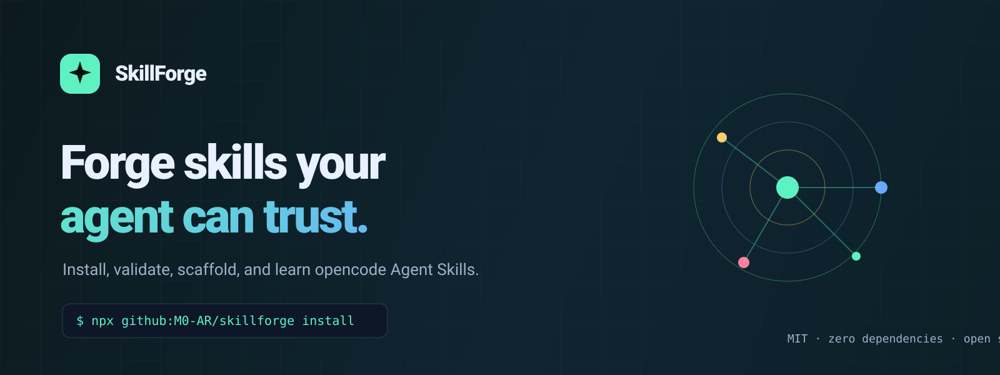
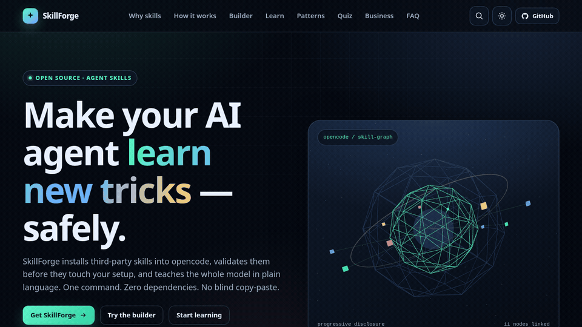
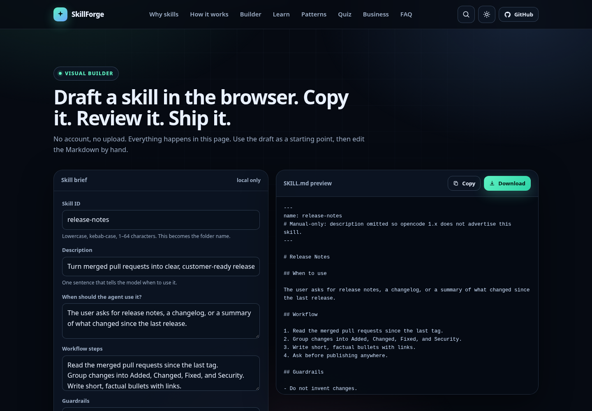
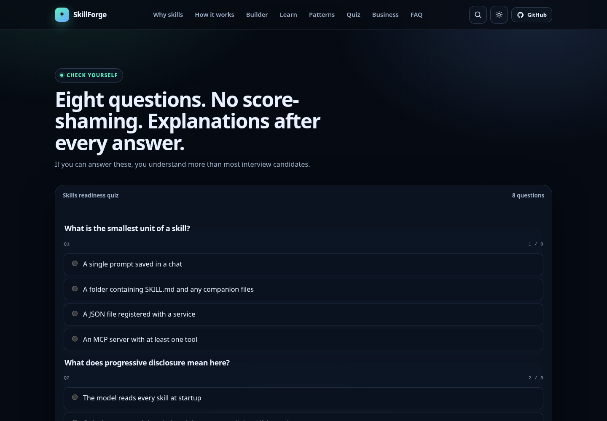
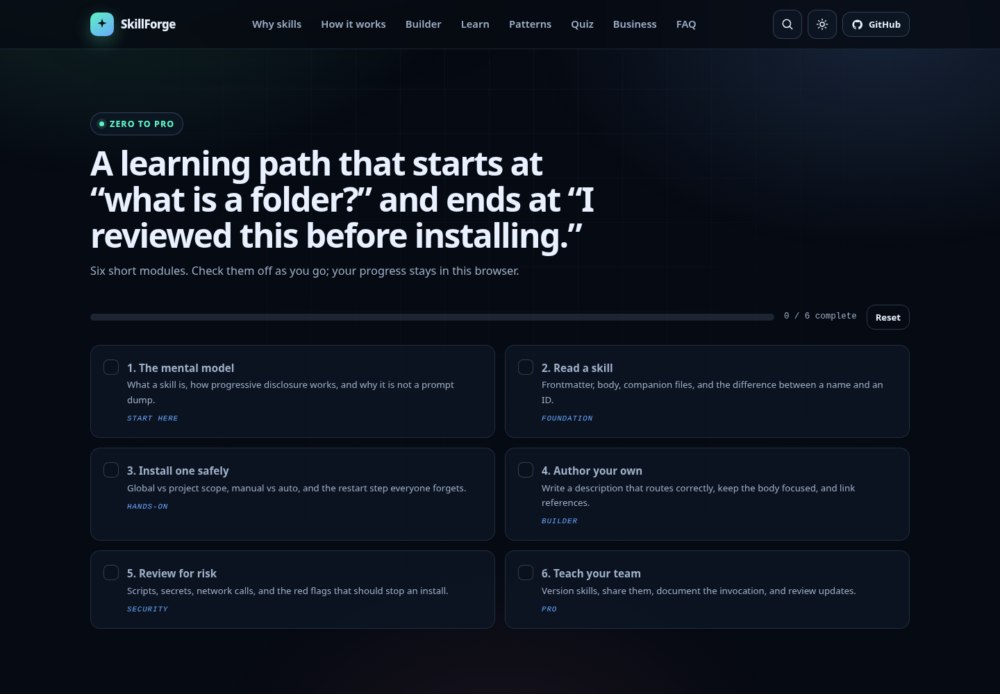

# SkillForge

**Install, validate, scaffold, and learn opencode Agent Skills — with one friendly command.**

[](LICENSE)
[](package.json)
[](package.json)
[](CONTRIBUTING.md)

**Website:** https://m0-ar.github.io/skillforge/  
**Docs:** [docs/](docs/) · **Security:** [SECURITY.md](SECURITY.md) · **Contributing:** [CONTRIBUTING.md](CONTRIBUTING.md)

---

## Abstract

AI agents are only as useful as the judgment we give them. A tool can call an API; a **skill**
can teach an agent how your team reviews a pull request, writes a release note, plans a migration,
or handles a support escalation. Skills are plain-text playbooks that load only when a task
matches, so they add depth without permanently inflating the context window.

SkillForge is the missing installation layer. It takes a skill from a repository or a local folder,
**validates it before it touches your setup**, copies the whole folder where opencode expects it,
and makes the visibility choice explicit: auto-advertised for trusted workflows, manual-only for
everything new. It also teaches the model from first principles, so a beginner can understand what
is happening and a senior engineer can review it without hand-waving.

The result is a small, auditable, zero-dependency toolkit and a learning site that turns “I found a
skill on GitHub” into “I reviewed it, installed it, verified it, and know how to remove it.”

**For decision makers:** lower onboarding time, reusable operating knowledge, a human review gate,
and no new runtime service to operate. **For engineers:** one command, deterministic file layout,
tests, and plain text you can diff.

## The 30-second version

```bash
npx github:M0-AR/skillforge install
```

Then restart opencode and run:

```text
/add-skill https://github.com/owner/skill-repo
```

That is the loop: **find → review → install → verify**. The installer defaults to manual-only,
because a new skill is unreviewed code.

<a id="beginner-guide"></a>
## Read 🌱 Beginner guide

If you have never installed a skill, start here. No prior agent experience is assumed.

Let's work this out in a step-by-step way to be sure we have the right answer.

1. **A skill is a folder.** It contains `SKILL.md` and, usually, a few companion files. The folder
   name is the skill ID.
2. **opencode looks in two places.** Globally in `~/.config/opencode/skills/`, or per project in
   `.opencode/skills/`.
3. **The description is a signpost.** It tells the model when the skill is relevant. It is not a
   summary for humans.
4. **Manual-only means “installed, but not advertised”.** You call it by name. This is the safe
   default for a skill you did not write.
5. **Restart opencode after installing.** Skill state is loaded at startup. This is the step
   everyone forgets.
6. **Verify, don't assume.** Run `opencode debug skill` and look for the skill ID.

That is enough to use the tool. The [learning path](docs/learning-path.md) goes from this model to
authoring, reviewing, and teaching skills. By the end, **You will know more than most interview candidates.** That is not a slogan; it is the point of the six modules.

## Why this exists

Installing a skill by hand is four easy steps and one dangerous one:

```text
find the folder → read it → copy it → restart → hope it worked
```

The dangerous part is “read it”. Most installation instructions skip the review, copy only
`SKILL.md`, break relative links, or leave the model advertising a skill nobody vetted.

SkillForge makes the careful path the default path:

- validates the folder structure and companion links
- copies the whole folder, not just the main file
- picks the right command directory for opencode 1.x or 2.x
- defaults to manual-only
- tells you exactly how to verify and how to remove it

## What you get

| Piece | What it does |
| --- | --- |
| **CLI** | `install`, `add`, `validate`, `scaffold`, `list`, `doctor` — zero runtime dependencies |
| **Bundled helper** | A reviewed `add-skill` playbook that walks an agent through a safe install |
| **Learning site** | 3D hero, skill builder, pattern library, quiz, ROI sketch, and six-module path |
| **Docs** | Installation, visibility, authoring, security, CLI, troubleshooting, FAQ, publishing |
| **Examples** | A tiny `hello-skill` you can install in under a minute |
| **Tests** | Node's built-in test runner; no test framework to install |

## Demo



The demo shows the site, the builder, the learning path, and the quiz. The CLI flow is shown in
the [quickstart](#quickstart).

<p align="center">
  
  
</p>
<p align="center">
  
  
</p>

## Quickstart

### 1. Check your environment

```bash
opencode --version
node --version   # 18 or newer
git --version
```

### 2. Install the helper

From this repository:

```bash
node bin/skillforge.js install
```

Or directly from GitHub:

```bash
npx github:M0-AR/skillforge install
```

Expected output:

```text
Installed add-skill
  skill:   ~/.config/opencode/skills/add-skill
  command: ~/.config/opencode/command/add-skill.md
  mode:    manual-only (use /add-skill)
  opencode: 1.19.4
```

### 3. Restart opencode

Close it and open it again. Skill state is read at startup.

### 4. Use it

```text
/add-skill https://github.com/owner/skill-repo
```

### 5. Verify

```bash
opencode debug skill
```

Search for `add-skill`. If you chose manual-only on opencode 1.x, it should be registered without a
description in the debug output.

## Install paths

| Scope | Skills | Commands (opencode 1.x) | Commands (opencode 2.x) |
| --- | --- | --- | --- |
| Global | `~/.config/opencode/skills/<id>/` | `~/.config/opencode/command/` | `~/.config/opencode/commands/` |
| Project | `.opencode/skills/<id>/` | `.opencode/command/` | `.opencode/commands/` |

Use project scope when the skill belongs to one repository:

```bash
node bin/skillforge.js add ./examples/hello-skill --project --manual
```

## How it works

```text
┌─────────────┐   ┌──────────────┐   ┌───────────────┐   ┌──────────────┐
│ Find         │ → │ Review       │ → │ Install        │ → │ Verify       │
│ the folder   │   │ + validate   │   │ whole folder   │   │ + restart    │
└─────────────┘   └──────────────┘   └───────────────┘   └──────────────┘
```

1. **Find.** A skill is a folder with `SKILL.md`. A repository can contain several; choose one
   deliberately.
2. **Review and validate.** Check frontmatter, companion links, scripts, secrets, and
   permissions. `skillforge validate` catches broken links and missing files.
3. **Install.** Copy the whole folder to the chosen scope. Do not copy only `SKILL.md`.
4. **Verify.** Restart opencode, inspect `opencode debug skill`, and confirm the advertised state
   matches the mode you chose.

## Visibility: auto vs manual

| Mode | On opencode 1.x | On opencode 2.x | Best for |
| --- | --- | --- | --- |
| **Auto-advertised** | Keep `description` | Keep `description` | Reviewed, team-wide workflows |
| **Manual-only** | Remove `description`, add command file | Keep `description`, set `metadata.opencode/autoinvoke: false` | New, third-party, or risky skills |

The default is manual-only. It is reversible, and it keeps the model from loading an unreviewed
playbook on its own.

```yaml
---
name: release-notes
description: Turn merged pull requests into customer-ready release notes.
metadata:
  opencode/autoinvoke: false
---
```

See [docs/visibility.md](docs/visibility.md) for the exact command file and version differences.

## The CLI

```text
skillforge <command> [options]
```

| Command | Purpose |
| --- | --- |
| `install` | Install the bundled `add-skill` helper |
| `add <source>` | Install a skill from a local path or Git URL |
| `validate <path>` | Check a skill folder before installing |
| `scaffold <name>` | Create a starter skill folder |
| `list` | List installed skills and their visibility |
| `doctor` | Check Node, Git, opencode, paths, and permissions |

Common options: `--project`, `--auto`, `--manual`, `--name <id>`, `--force`, `--dry-run`, `--json`.

```bash
# Inspect the environment
node bin/skillforge.js doctor

# Validate before installing
node bin/skillforge.js validate ./skills/add-skill

# Install a local skill, manual-only
node bin/skillforge.js add ./examples/hello-skill --manual

# Pick one skill from a multi-skill repository
node bin/skillforge.js add https://github.com/owner/skill-repo --name release-notes --dry-run

# Start a new skill
node bin/skillforge.js scaffold release-notes --dir ./skills
```

Full reference: [docs/cli.md](docs/cli.md).

## Authoring a skill

```bash
node bin/skillforge.js scaffold release-notes --dir ./skills
```

A useful `SKILL.md` has four parts:

```markdown
---
name: release-notes
description: Turn merged pull requests into customer-ready release notes grouped by Added, Changed, Fixed, and Security.
---

# Release notes

## When to use
The user asks for release notes, a changelog, or a summary of what changed since a tag.

## Workflow
1. Read merged pull requests since the last tag.
2. Group changes into Added, Changed, Fixed, and Security.
3. Write short, factual bullets with links.
4. Ask before publishing.

## Guardrails
- Do not invent changes.
- Do not include customer names or secrets.
- Do not publish without explicit approval.

## Verification
Every bullet links to a real change, and the requested format is respected.
```

Guidance:

- Make the description a routing signal, not a marketing line.
- Keep the body a procedure.
- Move optional detail into `references/`.
- Make the verification observable.
- Validate before you share.

Full guide: [docs/authoring.md](docs/authoring.md).

## What you will learn

The [zero-to-pro path](docs/learning-path.md) has six modules:

1. **The mental model** — what a skill is, and why it is not a prompt dump.
2. **Read a skill** — frontmatter, body, companion files, and the name/ID distinction.
3. **Install one safely** — scope, visibility, restart, verification.
4. **Author your own** — descriptions that route, bodies that stay focused.
5. **Review for risk** — scripts, secrets, network calls, and red flags.
6. **Teach your team** — versioning, handoff, and update review.

Each module has an exercise and a success check. The site tracks your progress locally.

## Pattern library

The site ships twelve reusable shapes: pull-request review, release notes, migration planning,
missing tests, security pass, docs refresh, incident debugging, API design, data questions, support
replies, structured interviews, and sales briefs.

Search them at [the pattern library](https://m0-ar.github.io/skillforge/#patterns).

## Safety

A skill is instructions an agent may follow with your tools and permissions.

- Read `SKILL.md` and every companion file before installing.
- Check what it can read, write, execute, and send.
- Start manual-only.
- Pin a tag or commit for third-party skills.
- Review the diff before updating.
- Use least-privilege tokens.
- Report malicious skills instead of installing them.

The bundled validator checks structure and links. It does not sandbox the skill. Security review is
still a human responsibility. See [SECURITY.md](SECURITY.md) and
[docs/security.md](docs/security.md).

## For teams

Skills are an operating layer for repeatable judgment:

- **Onboarding:** capture the steps a senior person repeats.
- **Consistency:** standardize reviews, releases, migrations, and support replies.
- **Reviewability:** plain text that security and engineering can read.
- **Portability:** a folder, not a service.
- **Control:** manual-only by default, auto only after trust.

The site includes an illustrative ROI sketch. Use it to start a conversation, then measure cycle
time and rework in your own environment.

## Prompt dump vs MCP server vs Agent Skill

| | Prompt dump | MCP server | Agent Skill |
| --- | --- | --- | --- |
| Context cost | High, every turn | Tool definitions always on | Name + description until used |
| Runtime | None | A process or remote service | None |
| Best for | One-off instructions | Live systems and actions | Repeatable judgment and workflow |
| Review | Low | Code and permissions | Plain text, high |

Use the smallest layer that fits. Use both MCP and skills when the job needs both.

## FAQ

**Is this a package manager?** No. It copies folders and writes command files. No registry, no
lockfile, no signature.

**Do I need Node?** Only for the CLI. A skill is just a folder.

**Does it work with other agents?** The concepts are portable; the paths and visibility flags are
opencode-specific.

**Can I uninstall?** Yes. Remove the skill folder and the command file, then restart opencode.

**Does it collect telemetry?** No. The CLI is local. The site stores learning progress in your
browser only.

More: [docs/faq.md](docs/faq.md).

## Project structure

```text
skillforge/
├── bin/skillforge.js          # CLI entry
├── src/                       # install, validate, scaffold, doctor, helpers
├── skills/add-skill/          # the bundled helper skill
├── commands/                  # command templates
├── examples/hello-skill/      # a tiny installable example
├── docs/                      # guides and reference
├── test/                      # Node test runner
├── index.html                 # GitHub Pages site
├── preview.html               # generated mirror of index.html
├── styles.css
├── app.js
├── assets/                    # banner, favicon, screenshots, demo
└── scripts/                   # preview build
```

## Contributing

Small, tested changes are welcome. Read [CONTRIBUTING.md](CONTRIBUTING.md) first.

```bash
npm install       # no runtime dependencies; this only prepares local metadata
npm test
npm run lint
npm run site      # regenerate preview.html
```

## License

MIT. See [LICENSE](LICENSE).

---

**SkillForge** — because “it worked on my machine” is not a skill review.
